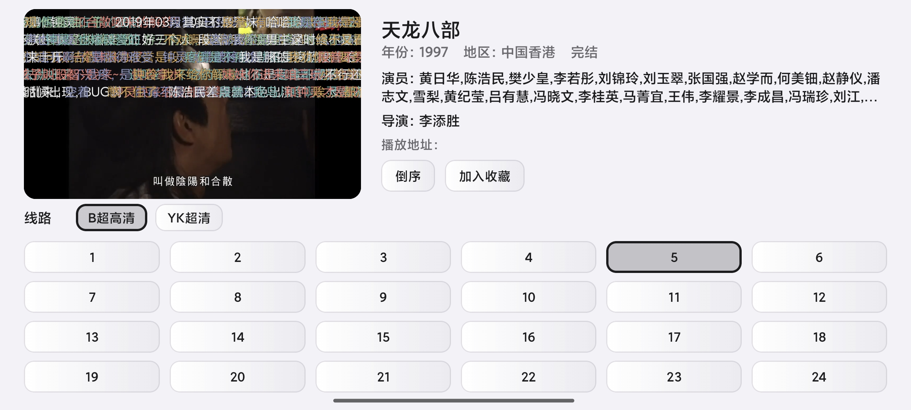

# danmu-api-deploy

自动构建 [huangxd-/danmu_api](https://github.com/huangxd-/danmu_api) 的 **linux/arm/v7** 镜像，供 32 位 ARM 盒子、老 NAS 拉取部署。

上游只提供 `amd64` / `arm64`，官方镜像 `logvar/danmu-api` 没有 32 位 ARM 版本，在 Hi3798MV100 这类设备上 `docker pull` 会报：

```
no matching manifest for linux/arm/v7 in the manifest list entries
```

本仓库补上这个缺口。

## 效果预览

盒子端接入本镜像后的实际效果（客户端：OneFilm）：




## 本仓库不存源码

只有 GitHub Actions 工作流和构建指纹 `last-build.txt`。每次构建时从上游 `git clone --depth 1` 取最新代码，构建完即弃。

## 产出镜像

| 通道 | 镜像 | 说明 |
| --- | --- | --- |
| Docker Hub（盒子实际拉取） | `<DOCKERHUB_USERNAME>/danmu-api:latest`<br>`:<版本号>` / `:armv7` / `:sha-<12位>` | 需配置 secrets |
| 阿里云 ACR 个人版（国内最快） | `registry.<地域>.aliyuncs.com/<命名空间>/danmu-api:latest` | 需配置 3 个 secrets |
| GHCR（备用） | `ghcr.io/viciy2023/danmu-api-deploy:latest` / `:armv7` / `:sha-<12位>` | 只需 GITHUB_TOKEN，包默认私有 |

- 平台：**`linux/arm/v7`**（单架构，不做多架构，构建更快）
- 基础镜像：强制锁定 `node:22-alpine`。原因见下方「已知限制」。

## 触发方式

- **定时**：每天 UTC 18:00（北京 02:00）
- **手动**：Actions → `Sync & Build danmu-api (linux/arm/v7)` → Run workflow
  - `force` 勾上 = 上游 SHA 未变化也强制重建

上游 SHA + `BUILD_REV` + Docker Hub 凭据状态 三者组成指纹，写入 `last-build.txt`，**完全没变化时跳过构建**。因此「先只推 GHCR、之后补配 Docker Hub」的情况下，配好 secrets 后会自动再构建一次，不会漏推。

## 首次启用步骤

1. 仓库 → **Settings → Secrets and variables → Actions → New repository secret**

   | Secret | 值 |
   | --- | --- |
   | `DOCKERHUB_USERNAME` | 你的 Docker Hub 用户名 |
   | `DOCKERHUB_TOKEN` | Docker Hub Access Token，权限选 **Read & Write** |

   Token 在 Docker Hub → Account settings → Security → New Access Token 生成。

   **可选：阿里云 ACR 个人版**（国内拉取最快，盒子优先用它）

   | Secret | 值 |
   | --- | --- |
   | `ALIYUN_USERNAME` | 你的阿里云账号全名 |
   | `ALIYUN_PASSWORD` | ACR「访问凭证」里设置的固定密码，不是登录密码 |
   | `ALIYUN_REGISTRY` | ACR 实例域名，形如 `<实例前缀>.cn-guangzhou.personal.cr.aliyuncs.com` |
   | `ALIYUN_NAMESPACE` | ACR 命名空间，需先在控制台创建 |

   产出地址：

   ```
   <ALIYUN_REGISTRY>/<ALIYUN_NAMESPACE>/danmu-api-deploy:<标签>
   ```

   ⚠️ ACR **不会自动建仓库**，必须先在控制台建好命名空间和仓库 `danmu-api-deploy`，否则推送会报 `name unknown`。

   四个 `ALIYUN_*` 凭据齐备才会推 ACR，缺任何一个自动跳过，不影响其他通道。

2. **Actions** → 左侧 `Sync & Build danmu-api (linux/arm/v7)` → **Run workflow**
   - 勾上 `force`，点 Run
   - 首次构建预计 **15–30 分钟**（armv7 靠 QEMU 模拟，`npm install` 很慢）
   - 之后有 GHA 层缓存会快很多

3. 构建完成后确认镜像存在：
   ```bash
   docker manifest inspect <DOCKERHUB_USERNAME>/danmu-api:latest | grep -i architecture
   # 期望看到 "architecture": "arm"
   # "variant": "v7"
   ```

> `DOCKERHUB_USERNAME` / `DOCKERHUB_TOKEN` 没配时工作流不会失败，只推 GHCR。

## 盒子端部署

先确认盒子能连上 Docker Hub：

```sh
curl -m 8 -sI https://registry-1.docker.io/v2/ | head -1
# 期望 HTTP/1.1 401 Unauthorized；超时则要先配 registry mirror，或改用 ghcr.io
```

`docker-compose.yml`：

```yaml
services:
  danmu-api:
    image: <DOCKERHUB_USERNAME>/danmu-api:latest
    container_name: danmu-api
    restart: unless-stopped
    ports:
      - "9321:9321"
    environment:
      - TZ=Asia/Shanghai
      - TOKEN=改成你自己的令牌
      # - ADMIN_TOKEN=后台管理令牌，可选
    volumes:
      - ./config:/app/config     # 目录里放 .env，修改后热加载
      - ./.cache:/app/.cache     # 收藏与缓存落盘
    mem_limit: 256m              # 1GB 内存设备必加
    logging:
      options:
        max-size: "10m"
        max-file: "3"
```

```bash
mkdir -p danmu-api/config danmu-api/.cache
cd danmu-api
docker compose up -d
docker logs -f danmu-api
```

访问 `http://<盒子IP>:9321/<TOKEN>/api/v2/search/anime?keyword=子夜归`。

## 更新流程

上游有新提交 → 定时任务自动构建并覆盖 `:latest` → 盒子执行：

```bash
docker compose pull && docker compose up -d
```

想钉死版本就用 `:sha-<12位>` 或 `:<上游版本号>` 标签，避免自动变化。

## 已知限制

| 限制 | 说明 |
| --- | --- |
| **Node 24 不再支持 arm/v7** | 实测 `node:24-alpine` 只有 `arm64/v8`。工作流已用 `sed` 强制锁回 `node:22-alpine`，上游升到 24 也不会崩。Node 22 LTS 维护到 2027-04。 |
| armv7 构建慢 | QEMU 模拟，首次 15–30 分钟；依赖 `npm install`（约 87 MB）是主要耗时。 |
| 构建不可复现 | 上游 `.gitignore` 明确忽略 `package-lock.json`，每次 `npm install` 都重新解析版本。若某天构建突然失败，先用同一 SHA 手动重跑一次确认是否依赖漂移。 |
| 60 天无提交会停用定时任务 | GitHub 官方行为。每次成功构建都会 commit `last-build.txt`，只要上游持续更新就不会触发；上游长期停更时需手动 Run workflow。 |
| Docker Hub 国内连通性 | 盒子在国内直连 `registry-1.docker.io` 常常超时，必要时配镜像加速或改用 GHCR / 阿里云 ACR。 |
| ACR 登录失败不阻塞 | `Log in to Aliyun ACR` 设了 `continue-on-error`，凭据错误只会跳过 ACR 并产生一条 warning，Docker Hub / GHCR 照常推送。排查时看该步骤的 annotation。 |

## 构建策略备注

- `provenance: false`：关闭 buildx attestation，避免 manifest 里出现 `unknown` 架构条目，老版本 Docker 拉取更稳。
- `cache-from/to: type=gha`：复用层缓存，第二次构建能省掉大部分 `npm install` 时间。
- 只构建单架构 `linux/arm/v7`，不做 `amd64,arm64` 多架构，减少构建时间。
